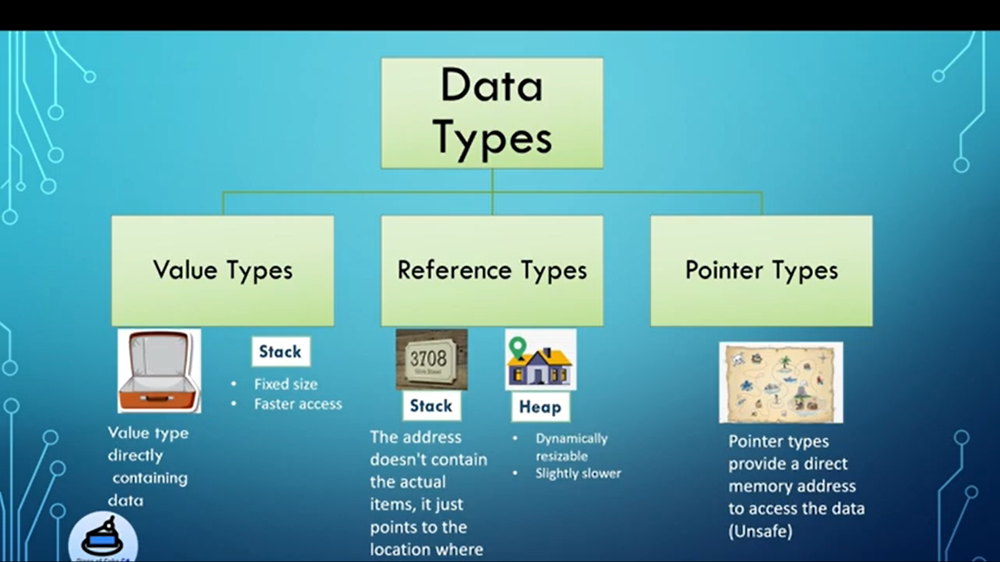
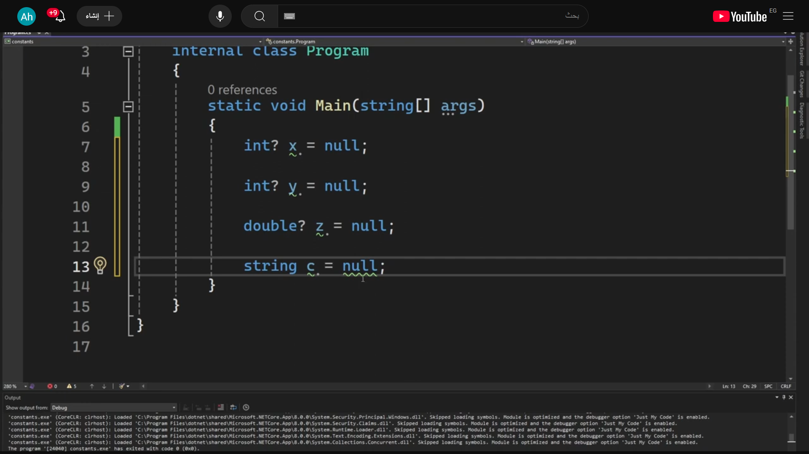

# C# Basics:

### **C# Variables:**

**Syntax:**

> type variable_name = value;  or  type variable_names;
> 

# Rules for Naming Variables

- Variable names can contain the letters ‘a-z’ or ‘_’.
- The name of the variables cannot be started with a digit.
- The name of the variable cannot be any C# keyword

           like →  int x = 32;

                                  ………………………………………………………………………………………………………………………………………………………………………………..

**Data Types in C# is Mainly Divided into 3 Categories:**

- Value Data Types
- Reference Data Types
- Pointer Data Type



# 1. Value Data Types

In C#, the Value Data Types will directly store the variable value in memory like int ,double


# 2. Reference Data Types

The Reference Data Types will contain a memory address of variable value because the reference types won’t store the variable value directly in memory. When you create a reference type variable, such as an object or a string, you are actually storing a reference (or pointer) to the location in memory like object and string

# 3. Pointer Data Type

The Pointer Data Types will contain a memory address of the variable value  like *


                                  ………………………………………………………………………………………………………………………………………………………………………………..

                                       

# C# Type Casting:

Type conversion happens when we assign the value of one data type to another.


**1. Implicit Type Casting:**  

```
    int i = 57;
    long l = i;
    float f = l;

```

**2. Explicit Type Casting:**

```
    double d = 765.12;
    // larger data into smaller data type
    int i = (int)d;

```


                                          ………………………………………………………………………………………………………………………………………………………………………………..

## **Getting User Input in C#:**


                                          ………………………………………………………………………………………………………………………………………………………………………………..


---

## **C# Operators:**

are special types of symbols which perform operations on variables or values

# 1. Arithmetic Operators

Arithmetic operators are used to perform basic mathematical operations on numeric values.

- ( + )  ( - ) ( * ) ( / )  ( % )   → مثلا يجمع ارقام ويجمع استرنج+

# 2. Relational Operators

Relational operators are used to compare values

- ( == ) ( != ) (<) (>) (≥)

# 3. Logical Operators

Used when multiple conditions and there we can combine these to compare complex conditions.

- **Logical AND (&&) :** returns true when both conditions are true.
- **Logical OR ( || ) :** returns true if at least one condition is true.
- **Logical NOT ( ! ):** returns true when a condition is false and vice-versa

# 4. Assignment Operators

Assignment operators are used to assign values to variables. The assignment operator is combined with others to create shorthand compound statements. Common compound operators include:

- **+= /= %=**

# 5. Increment/Decrement Operators

Increment and decrement operators are used to increase or decrease the value of a variable by 1.

- **++ (Increments by 1)**
    - Post-Increment: Uses value first, then increments.
    - Pre-Increment: Increments first, then uses value.
- **-** (**Decrements by 1)**
    - Post-Decrement: Uses value first, then decrements.
    - Pre-Decrement: Decrements first, then uses the value.
    
    # 6. Bitwise Operators
    
    Bitwise operators are used to perform bit-level operations on integer values
    

# 7. Ternary Operator

The ternary operator is a shorthand for an if-else statement. It evaluates a condition and returns one of two values depending on whether the condition is true or false.

> condition ? if true : if false
> 

                                     ………………………………………………………………………………………………………………………………………………………………………………..

### Conditional Statements of C#


There are few conditional statements of C# is mentioned below:

- if   →

*if ( condition ) {*

*//code to be executed*

*}*

- if-else →

*f(condition)*

*{*

*// code if condition is true*

*}*

*else*

*{*

*// code if condition is false*

*}*

- Switch →


*switch (expression)*

*{*

*case value1: // statement sequence*

*break;*

*case value2: // statement sequence*

*break;*

*.*

*.*

*.*

*case valueN: // statement sequence*

*break;*

*default: // default statement sequence*

*}*

                                     ………………………………………………………………………………………………………………………………………………………………………………..

## **C# Loops:**


### **1 while Loop**

The test condition is given at the beginning of the loop, and all statements are executed till the given Boolean condition is satisfied. When the condition becomes false, the control will be out of the while loop.

**Syntax:**

> while (boolean condition){        loop statements...}
> 

2 For loop

**Syntax:**

> for (loop variable initialization ; testing condition; increment / decrement){         // statements to be executed}
> 

3-

### **do-while loop**

The **do while loo**p is similar to while loop with the only difference that it checks the condition after executing the statements, i.e it will execute the loop body one time for sure because it checks the condition after executing the statements.

**Syntax :**

> do{     statements..} while (condition);
> 

# Syntax of foreach Loop

> foreach (data_type variable_name in collection){    // Code to execute for each element}
> 

                                     ………………………………………………………………………………………………………………………………………………………………………………..

## **Array Initialization:**


| **Syntax** | **Use Cases** | **Example** |
| --- | --- | --- |
| <data_type>[] <arr_name> = new <data_type>[size]; | Defining array with size, but not assigns values | int[] arr1 = new int[5]; |
| <data_type>[] <arr_name> = new <data_type>[size]{ array_elements}; | Defining array with size and assigning the values at the same time | int[] arr2 = new int[5]{1, 2, 3, 4, 5}; |
| <data_type>[] <arr_name> = { array_elements}; | The value of the array is directly initialized without taking its size | int[] intArray3 = {1, 2, 3, 4, 5}; |


some methods in array → 

array name .length() /  array name Max /  array name .sum / array name .average→ return double 

Array. Sort(Array name) → sort , Array. Reverse(Array name) →reverse 

**Multi-dimensional::**


**Jagged arrays::**


---

# Defining the capacity of StringBuilder

Although the **StringBuilder** is a dynamic object that allows you to expand the number of characters in the string that it encapsulates, you can specify a value for the maximum number of characters that it can hold. This value is called the capacity of the **StringBuilder** object.

```
StringBuilder s = new StringBuilder(20);

or

StringBuilder s = new StringBuilder("MANSOURA", 8);
```


escape character → /  or @ before string

# Methods of C# String

| **Method**
 | **Description** | **Return Type** | **Example** |
| --- | --- | --- | --- |
| **IndexOf** | Finds the index of the first occurrence of a specified character or substring. | Integer | text.IndexOf("World"); |
| concat(x,y) | x+y  |  |  |
|  |  |  |  |
| **ToUpper** | Converts a string to uppercase. | String | text.ToUpper(); |
| **ToLower** | Converts a string to lowercase. | String | text.ToLower(); |
| **Split** | Splits a string into an array based on a specified delimiter. | String Array | fruits.Split(','); |
|  |  |  |  |
| **Contains** | Checks if a string contains a specified substring. | Boolean | text.Contains("World"); |
|  |  |  |  |
|  |  |  |  |
| **Remove** | Removes characters from a string starting at a specified index. | String | text.Remove(5, 7); |
| **Insert** | Inserts a string at a specified index. | String | text.Insert(5, " Beautiful"); |
| **Trim** | Removes leading and trailing whitespaces. | String | text.Trim(); |
| **Replace** | Replaces occurrences of a substring with another substring. | String | text.Replace("fun", "awesome"); |

---

nullable:




---

## **Exception Handling::**

C# provides **try-catch** and **finally blocks** to handle exceptions effectively.

**Syntax:**

> try{    // Code that may throw an exception}catch (ExceptionType ex){    // Handle the exception}finally{    // Cleanup code (optional)}
> 

An exception is defined as an event that occurs during the execution of a program that is unexpected by the program code

we create an exception object and call the exception handler code. The execution of an exception handler so that the program code does not crash is called exception handling. Exception handling is important because it gracefully handles an unwanted event, an exception so that the program code still makes sense to the user.

| **Keyword** | **Definition** |
| --- | --- |
| **try** | **Used to define a try block. This block holds the code that may throw an exception.** |
| **catch** | **Used to define a catch block. This block catches the exception thrown by the try block.** |
| **finally** | **Used to define the finally block. This block holds the default code.** |
| **throw** | **Used to throw an exception manually.** |


---

# Declaring a Method →DRY (DON’T REPEAT YOUR  SELF)

The method signature consists of the method name and its parameter list. It uniquely identifies the method within its class. Below image is how we define a signature of the method.


- **Access Modifier:** Defines the visibility of the method. by default → private
- **Return Type:** Specifies the type of value the method returns.
- **Method Name:** The name used to call the method.
- **Parameters**: A list of inputs the method can take and it is optional
- **Method Body:** The block of code that defines what the method does

# Method Calling:

Direct method calling occurs when you invoke a method using an instance of its class :     Display Message();

multiply(a:10,b:20)  ممكن احدد ف الكول انا باعته ايه 
default num → parameter list ( int x, int <u>y=10</u>)  

main → entry point 

# Method Parameters

Methods can accept parameters to perform operations based on input values. Below is a table summarizing different types of parameters:

| **Parameter** | **Description** | **Example** |
| --- | --- | --- |
| **Value** | Passes a copy of the argument | void Display(int x) |
| **Reference** | Passes a reference to the argument | void Update(ref int x) |


In C#, both `ref` and `out` keywords are used to pass arguments by reference to methods, meaning changes made to the parameter within the method are reflected in the original variable outside the method, but they have distinct requirements regarding variable initialization. The `ref` keyword requires the argument to be initialized *before* being passed to the method, while the `out` keyword does *not* require prior initialization, but mandates that the method *must* assign a value to the `out` parameter before the method concludes execution. 


Method overloading, also known as function overloading, is

**a feature in object-oriented programming where multiple methods within the same class can have the same name, but different parameters (number, type, or order)**

. This allows for a single method name to be used to perform similar tasks with varying inputs.

**Key aspects of method overloading:**

- **Same Name, Different Signatures**

---

# Recursion in C#

Recursion is a function that calls itself. Or in other words, recursion is a process where a function calls itself repeatedly until some specified conditions have been completed. It is just like a loop; in the loop, if the condition is satisfied, the function will call itself similarly if the condition is satisfied.


**C# Debugging → Break point ,step over, step into (into method ) ,step out (out method not loop) ,watch (monitor variable) ,**

**call stack (methods تسلسل  ),data pin ( قدامك تثبيت variable) ,immediate window (اكتب حاجه يجبلي قيمتها الحاليه).**